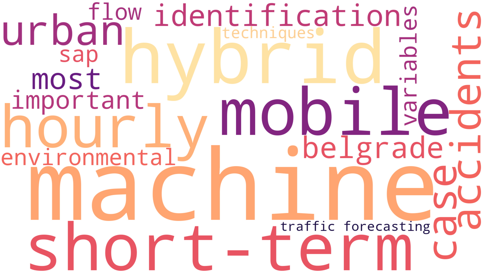
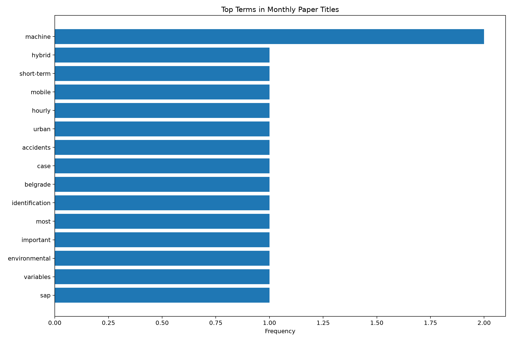
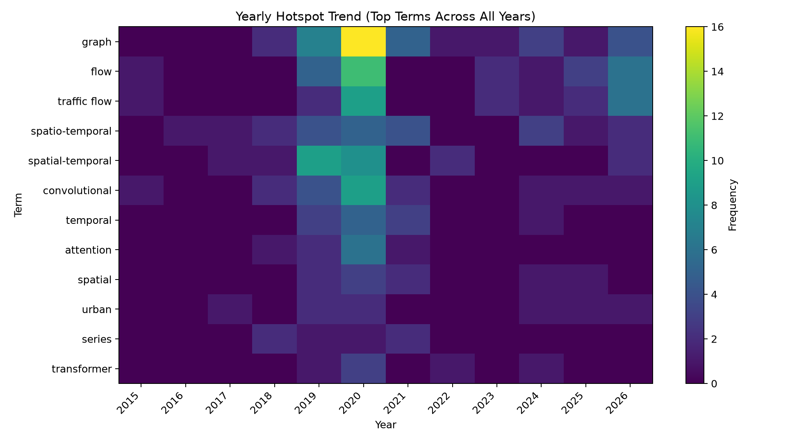
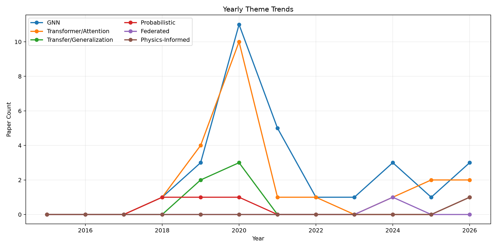

# Awesome Traffic Prediction

Chinese version: [README.zh.md](./README.zh.md)

[![Forks][forks-shield]][forks-url]
[![Stargazers][stars-shield]][stars-url]

This repository contains useful resources for traffic prediction, including popular papers, datasets, tutorials, toolkits, and other helpful repositories.

## Visual Highlights

Latest monthly title-term word cloud:

Latest Top-K term frequency chart:

Yearly hotspot comparison:

Yearly theme trend lines:

<!-- START doctoc generated TOC please keep comment here to allow auto update -->
<!-- DON'T EDIT THIS SECTION, INSTEAD RE-RUN doctoc TO UPDATE -->

- [0x00 Papers](#0x00-papers)
  - [Reviews](#reviews)
  - [Deep Learning Based Traffic Prediction Methods](#deep-learning-based-traffic-prediction-methods)
  - [Curated Digest (Recent Years)](#curated-digest-recent-years)
  - [Statistic Based Traffic Prediction Methods](#statistic-based-traffic-prediction-methods)
  - [Time Series Forecasting](#time-series-forecasting)
  - [Temporal Network Embedding](#temporal-network-embedding)
- [0x01 Tutorial](#0x01-tutorial)
  - [Textbook](#textbook)
  - [Blogs](#blogs)
- [0x02 DataSource](#0x02-datasource)
  - [Datasets](#datasets)
  - [Trajectory](#trajectory)
  - [ETA](#eta)
  - [Website](#website)
- [0x03 Toolkits](#0x03-toolkits)
- [0x04 Conferences & Journals](#0x04-conferences--journals)
- [0x05 Research Group](#0x05-research-group)
  - [Company](#company)
  - [College](#college)
- [0x06 Related Repositories](#0x06-related-repositories)
- [0x07 Benchmark & Evaluation](#0x07-benchmark--evaluation)
  - [Benchmark Matrix](#benchmark-matrix)
  - [Auto Trend Visuals](#auto-trend-visuals)
- [Contribution](#contribution)

<!-- END doctoc generated TOC please keep comment here to allow auto update -->

## 0x00 Papers

### Reviews

1. [TITS 2015] Traffic Flow Prediction With Big Data: A Deep Learning Approach [[paper]](https://bookdown.org/amanas/traficomadrid/docs/Traffic%20flow%20prediction%20with%20big%20data%20-%20A%20deep%20learning%20approach.pdf)
2. [KDD 2020] Deep Learning for Spatio-Temporal Data Mining: A Survey [[paper]](https://ieeexplore.ieee.org/abstract/document/9204396/)
3. [Information Fusion 2020] Urban flow prediction from spatiotemporal data using machine learning: A survey [[paper]](https://www.sciencedirect.com/science/article/pii/S1566253519303094)
4. [Arxiv 2020] Deep Learning on Traffic Prediction: Methods, Analysis and Future Directions [[paper]](https://arxiv.org/abs/2004.08555)
5. [Arxiv 2021] Graph Neural Network for Traffic Forecasting:  A Survey [[paper]](https://arxiv.org/abs/2101.11174)
6. [Applied Intelligence 2022] Spatial-temporal graph neural network for traffic forecasting: An overview and open research issues [[paper]](https://link.springer.com/content/pdf/10.1007/s10489-021-02587-w.pdf)

### Deep Learning Based Traffic Prediction Methods

<!-- START AUTO RECENT PAPERS -->
#### 2015

1. [NeurIPS 2015] Convolutional LSTM Network: A Machine Learning Approach for Precipitation Nowcasting [[paper]](https://doi.org/10.48550/arxiv.1506.04214)
2. [TITS 2015] Traffic Flow Prediction With Big Data: A Deep Learning Approach [[paper]](https://doi.org/10.1109/tits.2014.2345663)

#### 2016

1. [SIGSPATIAL 2016] DNN-Based Prediction Model for Spatio-Temporal Data [[paper]](https://doi.org/10.1145/2996913.2997016) [[code]](https://arxiv.org/pdf/1610.00081.pdf)

#### 2017

1. [AAAI 2017] Deep Spatio-Temporal Residual Networks for Citywide Crowd Flows Prediction [[paper]](https://arxiv.org/pdf/1610.00081.pdf)
2. [ISPRS IJGI 2017] Road2Vec: Measuring Traffic Interactions in Urban Road System from Massive Travel Routes [[paper]](https://doi.org/10.3390/ijgi6110321)
3. [arXiv 2017] DeepTransport: Learning Spatial-Temporal Dependency for Traffic Condition Forecasting [[paper]](https://arxiv.org/pdf/1709.09585.pdf)

#### 2018

1. [ICLR 2018] Diffusion Convolutional Recurrent Neural Network: Data-Driven Traffic Forecasting [[paper]](https://arxiv.org/abs/1707.01926) [[code-official-tf]](https://github.com/liyaguang/DCRNN) [[code-pytorch]](https://github.com/xlwang233/pytorch-DCRNN) [[data]](https://drive.google.com/drive/folders/10FOTa6HXPqX8Pf5WRoRwcFnW9BrNZEIX?usp=drive_open)
2. [IJCAI 2018] Spatio-Temporal Graph Convolutional Networks: A Deep Learning Framework for Traffic Forecasting [[paper]](https://doi.org/10.24963/ijcai.2018/505) [[code]](https://github.com/VeritasYin/STSGCN)
3. [AAAI 2018] Deep Multi-View Spatial-Temporal Network for Taxi Demand Prediction [[paper]](https://doi.org/10.1609/aaai.v32i1.11836) [[code]](https://github.com/huaxiuyao/DMVST-Net) [[data]](https://outreach.didichuxing.com/appEn-vue/Personal)
4. [IJCAI 2018] GeoMAN: Multi-level Attention Networks for Geo-sensory Time Series Prediction [[paper]](https://doi.org/10.24963/ijcai.2018/476)
5. [KDD 2018] Hetero-ConvLSTM: A Deep Learning Approach to Traffic Accident Prediction on Heterogeneous Spatio-Temporal Data [[paper]](https://doi.org/10.1145/3219819.3219922)
6. [IJCAI 2018] LC-RNN: A Deep Learning Model for Traffic Speed Prediction [[paper]](https://doi.org/10.24963/ijcai.2018/482)
7. [TITS 2018] Missing Value Imputation for Traffic-Related Time Series Data Based on a Multi-View Learning Method [[paper]](https://doi.org/10.1109/tits.2018.2869768)
8. [TITS 2018] Probabilistic Data Fusion for Short-Term Traffic Prediction With Semiparametric Density Ratio Model [[paper]](https://doi.org/10.1109/tits.2018.2866285)
9. [CVPR 2018] Social GAN: Socially Acceptable Trajectories with Generative Adversarial Networks [[paper]](https://arxiv.org/abs/1803.10892) [[code]](https://github.com/agrimgupta92/sgan)
10. [CS224W 2018] Efficient Traffic Forecasting With Graph Embedding [[paper]](http://snap.stanford.edu/class/cs224w-2018/reports/CS224W-2018-42.pdf) [[code]](https://github.com/syin3/cs224w-traffic)

#### 2019

1. [AAAI 2019] Attention Based Spatial-Temporal Graph Convolutional Networks for Traffic Flow Forecasting [[paper]](https://doi.org/10.1609/aaai.v33i01.3301922) [[code-pytorch]](https://github.com/guoshnBJTU/ASTGCN-r-pytorch)
2. [IJCAI 2019] Graph WaveNet for Deep Spatial-Temporal Graph Modeling [[paper]](https://doi.org/10.24963/ijcai.2019/264) [[code]](https://github.com/nnzhan/Graph-WaveNet)
3. [KDD 2019] Urban Traffic Prediction from Spatio-Temporal Data Using Deep Meta Learning [[paper]](https://doi.org/10.1145/3292500.3330884) [[code]](https://github.com/panzheyi/ST-MetaNet)
4. [TR-C 2019] A generalized Bayesian traffic model [[paper]](https://doi.org/10.1016/j.trc.2019.09.011)
5. [ICLR 2019] Context-aware Forecasting for Multivariate Stationary Time-series [[paper]](https://openreview.net/pdf?id=B1xHUiC5tm)
6. [TITS 2019] Contextualized Spatial–Temporal Network for Taxi Origin-Destination Demand Prediction [[paper]](https://doi.org/10.1109/tits.2019.2915525) [[code]](https://github.com/liulingbo918/CSTN)
7. [TITS 2019] Deep Spatial-Temporal 3D Convolutional Neural Networks for Traffic Data Forecasting [[paper]](https://doi.org/10.1109/tits.2019.2906365)
8. [AAAI 2019] DeepSTN+: Context-aware Spatial-Temporal Neural Network for Crowd Flow Prediction in Metropolis [[paper]](https://doi.org/10.1609/aaai.v33i01.33011020) [[code]](https://github.com/FIBLAB/DeepSTN)
9. [TKDE 2019] Flow prediction in spatio-temporal networks based on multitask deep learning [[paper]](https://doi.org/10.1109/tkde.2019.2891537)
10. [IJCAI 2019] GSTNet: Global Spatial-Temporal Network for Traffic Flow Prediction [[paper]](https://doi.org/10.24963/ijcai.2019/317)
11. [WWW 2019] Learning from Multiple Cities: A Meta-Learning Approach for Spatial-Temporal Prediction [[paper]](https://doi.org/10.1145/3308558.3313577)
12. [CIKM 2019] Matrix Factorization for Spatio-Temporal Neural Networks with Applications to Urban Flow Prediction [[paper]](https://doi.org/10.1145/3357384.3357832)
13. [AAAI 2019] Multi-Range Attentive Bicomponent Graph Convolutional NetworkforTraicForecasting [[paper]](https://arxiv.org/abs/1911.12093)
14. [AAAI 2019] Revisiting Spatial-Temporal Similarity: A Deep Learning Framework for Traffic Prediction [[paper]](https://arxiv.org/pdf/1803.01254v2.pdf) [[code]](https://github.com/tangxianfeng/STDN)
15. [ICCV 2019] STGAT: Modeling Spatial-Temporal Interactions for Human Trajectory Prediction [[paper]](https://doi.org/10.1109/iccv.2019.00637) [[code]](https://github.com/huang-xx/STGAT)
16. [TITS 2019] T-GCN: A Temporal Graph Convolutional Network for Traffic Prediction [[paper]](https://arxiv.org/pdf/1811.05320v3.pdf) [[code]](https://github.com/lehaifeng/T-GCN)
17. [TITS 2019] TrafficGAN: Network-Scale Deep Traffic Prediction With Generative Adversarial Nets [[paper]](https://doi.org/10.1109/tits.2019.2955794)
18. [Access 2019] Spatial-Temporal Graph Attention Networks: A Deep Learning Approach for Traffic Forecasting [[paper]](https://doi.org/10.1109/access.2019.2953888)
19. [IJGIS 2019] Traffic speed prediction for intelligent transportation system based on a deep feature fusion model [[paper]](https://doi.org/10.1080/15472450.2019.1583965)
20. [arXiv 2019] Forecaster: A graph transformer for forecasting spatial and time dependent data [[paper]](https://arxiv.org/abs/1909.04019)
21. [IWPHM 2019] Spatio-Temporal Clustering of Traffic Data with Deep Embedded Clustering [[paper]](https://doi.org/10.1145/3356995.3364537)
22. [arXiv 2019] Temporal fusion transformers for interpretable multi-horizon time series forecasting [[paper]](https://arxiv.org/abs/1912.09363)

#### 2020

1. [NeurIPS 2020] Adaptive Graph Convolutional Recurrent Network for Traffic Forecasting [[paper]](https://arxiv.org/abs/2007.02842) [[code]](https://github.com/LeiBAI/AGCRN)
2. [AAAI 2020] GMAN: A Graph Multi-Attention Network for Traffic Prediction [[paper]](https://arxiv.org/abs/1911.08415) [[code]](https://github.com/zhengchuanpan/GMAN)
3. [AAAI 2020] Spatial-Temporal Synchronous Graph Convolutional Networks: A New Framework for Spatial-Temporal Network Data Forecasting [[paper]](https://ojs.aaai.org/index.php/AAAI/article/view/5438) [[code]](https://github.com/Davidham3/STSGCN)
4. [arXiv 2020] Spatial-Temporal Fusion Graph Neural Networks for Traffic Flow Forecasting [[paper]](https://arxiv.org/abs/2012.09641) [[code]](https://github.com/MengzhangLI/STFGNN)
5. [TITS 2020] A Spatial-Temporal Attention Approach for Traffic Prediction [[paper]](https://www.researchgate.net/publication/340567373_A_Spatial-Temporal_Attention_Approach_for_Traffic_Prediction)
6. [KDD 2020] ConSTGAT: Contextual Spatial-Temporal Graph Attention Network for Travel Time Estimation at Baidu Maps [[paper]](https://www.kdd.org/kdd2020/accepted-papers/view/constgat-contextual-spatial-temporal-graph-attention-network-for-travel-tim)
7. [KDD 2020] Deep Learning for Spatio-Temporal Data Mining: A Survey [[paper]](https://ieeexplore.ieee.org/abstract/document/9204396/)
8. [AAAI 2020] Learning Geo-Contextual Embeddings for Commuting Flow Prediction [[paper]](https://ojs.aaai.org//index.php/AAAI/article/view/5425)
9. [KDD 2020] Preserving Dynamic Attention for Long-Term Spatial-Temporal Prediction [[paper]](https://arxiv.org/abs/2006.08849)
10. [Information Fusion 2020] Spatial Temporal Incidence Dynamic Graph Neural Networks for Traffic Flow Forecasting [[paper]](https://www.sciencedirect.com/science/article/abs/pii/S0020025520300451?via%3Dihub)
11. [AAAI 2020] Spatio-Temporal Graph Structure Learning for Traffic Forecasting [[paper]](https://ojs.aaai.org//index.php/AAAI/article/view/5470)
12. [TKDE 2020] Spatio-Temporal Meta Learning for Urban Traffic Prediction [[paper]](https://ieeexplore.ieee.org/document/9096591)
13. [TITS 2020] Temporal Multi-Graph Convolutional Network for Traffic Flow Prediction [[paper]](https://ieeexplore.ieee.org/document/9098104)
14. [TITS 2020] Traffic Flow Imputation Using Parallel Data and Generative Adversarial Networks [[paper]](https://ieeexplore.ieee.org/document/8699108)
15. [WWW 2020] Traffic Flow Prediction via Spatial Temporal Graph Neural Network [[paper]](https://dl.acm.org/doi/abs/10.1145/3366423.3380186)
16. [TITS 2020] Traffic Graph Convolutional Recurrent Neural Network: A Deep Learning Framework for Network-Scale Traffic Learning and Forecasting [[paper]](https://ieeexplore.ieee.org/document/8917706) [[code]](https://github.com/zhiyongc/Graph_Convolutional_LSTM)
17. [ICDM 2020] TSSRGCN: Temporal Spectral Spatial Retrieval Graph Convolutional Network for Traffic Flow Forecasting [[paper]](https://ieeexplore.ieee.org/document/9338393)
18. [Information Fusion 2020] Urban flow prediction from spatiotemporal data using machine learning: A survey [[paper]](https://www.sciencedirect.com/science/article/pii/S1566253519303094)
19. [WWW 2020] What is the Human Mobility in a New City: Transfer Mobility Knowledge Across Cities [[paper]](http://urban-computing.com/pdf/www1208tianfu.pdf)
20. [Mobile Computing 2020] BuildSenSys: Reusing Building Sensing Data for Traffic Prediction with Cross-domain Learning [[paper]](https://ieeexplore.ieee.org/abstract/document/9018140)
21. [IJGIS 2020] Graph attention temporal convolutional network for traffic speed forecasting on road networks [[paper]](https://www.tandfonline.com/doi/abs/10.1080/21680566.2020.1822765?journalCode=ttrb20)
22. [Access 2020] STGAT: Spatial-Temporal Graph Attention Networks for Traffic Flow Forecasting [[paper]](https://ieeexplore.ieee.org/stamp/stamp.jsp?arnumber=9146162)
23. [TGIS 2020] Traffic transformer: Capturing the continuity and periodicity of time series for traffic forecasting [[paper]](https://onlinelibrary.wiley.com/doi/abs/10.1111/tgis.12644)
24. [Sensors 2020] City-Wide Traffic Flow Forecasting Using a Deep Convolutional Neural Network [[paper]](https://www.mdpi.com/1424-8220/20/2/421)
25. [ICTON 2020] Traffic Prediction in Optical Networks Using Graph Convolutional Generative Adversarial Networks [[paper]](https://ieeexplore.ieee.org/document/9203477)
26. [arXiv 2020] Bayesian Spatio-Temporal Graph Convolutional Network for Traffic Forecasting [[paper]](https://www.researchgate.net/publication/344678512_Bayesian_Spatio-Temporal_Graph_Convolutional_Network_for_Traffic_Forecasting)
27. [arXiv 2020] Deep Learning on Traffic Prediction: Methods, Analysis and Future Directions [[paper]](https://arxiv.org/abs/2004.08555)
28. [arXiv 2020] Informer: Beyond Efficient Transformer for Long Sequence Time-Series Forecasting [[paper]](https://arxiv.org/pdf/2012.07436.pdf) [[code]](https://github.com/zhouhaoyi/Informer2020)
29. [arXiv 2020] Spatial-Temporal Transformer Networks for Traffic Flow Forecasting [[paper]](https://arxiv.org/abs/2001.02908) [[code-not-official]](https://github.com/wubin5/STTN)
30. [arXiv 2020] ST-GRAT: A Novel Spatio-temporal Graph Attention Network for Accurately Forecasting Dynamically Changing Road Speed [[paper]](https://arxiv.org/abs/1911.13181)
31. [arXiv 2020] Transfer Learning with Graph Neural Networks for Short-Term Highway Traffic Forecasting [[paper]](https://arxiv.org/abs/2004.08038) [[code]](https://github.com/tanwimallick/TL-DCRNN)

#### 2021

1. [KDD 2021] Discrete-time Temporal Network Embedding via Implicit Hierarchical Learning in Hyperbolic Space [[paper]](https://dl.acm.org/doi/abs/10.1145/3447548.3467422)
2. [KDD 2021] Dynamic and Multi-faceted Spatio-temporal Deep Learning for Traffic Speed Forecasting [[paper]](https://dl.acm.org/doi/abs/10.1145/3447548.3467275)
3. [KDD 2021] Dynamic Graph Convolutional Recurrent Network for Traffic Prediction: Benchmark and Solution [[paper]](https://dl.acm.org/doi/10.1145/3532611) [[code]](https://github.com/tsinghua-fib-lab/Traffic-Benchmark)
4. [TITS 2021] Spatial‐temporal attention wavenet: A deep learning framework for traffic prediction considering spatial‐temporal dependencies [[paper]](https://ietresearch.onlinelibrary.wiley.com/doi/10.1049/itr2.12044)
5. [AAAI 2021] TS2Vec: Towards Universal Representation of Time Series [[paper]](https://www.aaai.org/AAAI22Papers/AAAI-8809.YueZ.pdf)
6. [PAKDD 2021] SST-GNN: Simplified Spatio-temporal Traffic forecasting model using Graph Neural Network [[paper]](https://arxiv.org/abs/2104.00055)
7. [IJCNN 2021] Unified Spatio-Temporal Modeling for Traffic Forecasting using Graph Neural Network [[paper]](https://arxiv.org/abs/2104.12518)
8. [arXiv 2021] Graph Neural Network for Traffic Forecasting: A Survey [[paper]](https://arxiv.org/abs/2101.11174)
9. [arXiv 2021] Spatio-temporal joint graph convolutional networks for traffic forecasting [[paper]](https://arxiv.org/abs/2111.13684)
10. [arXiv 2021] Time Series is a Special Sequence: Forecasting with Sample Convolution and Interaction [[paper]](https://arxiv.org/pdf/2106.09305v2.pdf) [[code]](https://github.com/cure-lab/SCINet)

#### 2022

1. [KDD 2022] Pre-training Enhanced Spatial-temporal Graph Neural Network [[paper]](https://arxiv.org/pdf/2206.09113.pdf)
2. [TITS 2022] 2F-TP:Learning Flexible Spatiotemporal Dependency for Flexible Traffic Prediction [[paper]](https://doi.org/10.1109/tits.2022.3146899)
3. [TR-C 2022] A Deep Learning Approach for Network-wide Dynamic Traffic Prediction during Hurricane Evacuation [[paper]](https://doi.org/10.1016/j.trc.2023.104126)
4. [TKDE 2022] A Graph and Attentive Multi-Path Convolutional Network for Traffic Prediction [[paper]](http://arxiv.org/abs/2205.15218v1)
5. [TKDE 2022] A Lightweight and Accurate Spatial-Temporal Transformer for Traffic Forecasting [[paper]](https://arxiv.org/pdf/2201.00008.pdf)
6. [TITS 2022] Automated Dilated Spatio-Temporal Synchronous Graph Modeling for Traffic Prediction [[paper]](http://arxiv.org/abs/2207.10830v1)
7. [CIKM 2022] Enhancing the Robustness via Adversarial Learning and Joint Spatial-Temporal Embeddings in Traffic Forecasting [[paper]](https://doi.org/10.1145/3583780.3614868)
8. [TITS 2022] Exploring Human Mobility for Multi-Pattern Passenger Prediction: A Graph Learning Framework [[paper]](http://arxiv.org/abs/2202.10339v1)
9. [TITS 2022] Few-Sample Traffic Prediction with Graph Networks using Locale as Relational Inductive Biases [[paper]](http://arxiv.org/abs/2203.03965v2)
10. [Information Fusion 2022] Multi-Spatio-temporal Fusion Graph Recurrent Network for Traffic forecasting [[paper]](http://arxiv.org/abs/2205.01480v2)
11. [TITS 2022] PGCN: Progressive Graph Convolutional Networks for Spatial-Temporal Traffic Forecasting [[paper]](http://arxiv.org/abs/2202.08982v3)
12. [AAAI 2022] Spatio-Temporal Meta-Graph Learning for Traffic Forecasting [[paper]](https://doi.org/10.1609/aaai.v37i7.25976)
13. [AAAI 2022] Spatio-Temporal Self-Supervised Learning for Traffic Flow Prediction [[paper]](https://doi.org/10.1609/aaai.v37i4.25555)
14. [ICDE 2022] Uncertainty Quantification for Traffic Forecasting: A Unified Approach [[paper]](https://doi.org/10.1109/icde55515.2023.00081)
15. [Neural Networks 2022] A Graph-based U-Net Model for Predicting Traffic in unseen Cities [[paper]](http://arxiv.org/abs/2202.06725v4)
16. [DMKD 2022] Graph Convolutional Networks for Traffic Forecasting with Missing Values [[paper]](http://arxiv.org/abs/2212.06419v1)
17. [SSCI 2022] Simpler is better: Multilevel Abstraction with Graph Convolutional Recurrent Neural Network Cells for Traffic Prediction [[paper]](http://arxiv.org/abs/2209.03858v1)
18. [CCIS 2022] Spatial-Temporal Adaptive Graph Convolution with Attention Network for Traffic Forecasting [[paper]](https://doi.org/10.1007/978-981-19-8915-5_8)
19. [Applied Intelligence 2022] Spatial-temporal graph neural network for traffic forecasting: An overview and open research issues [[paper]](https://doi.org/10.1007/s10489-021-02587-w)
20. [Neural Networks 2022] Spatio-Temporal Latent Graph Structure Learning for Traffic Forecasting [[paper]](https://doi.org/10.1109/ijcnn55064.2022.9892191)
21. [LNCS 2022] STLGRU: Spatio-Temporal Lightweight Graph GRU for Traffic Flow Prediction [[paper]](https://doi.org/10.1007/978-981-97-2266-2_23)
22. [arXiv 2022] A spatial-temporal short-term traffic flow prediction model based on dynamical-learning graph convolution mechanism [[paper]](http://arxiv.org/abs/2205.04762v1)
23. [arXiv 2022] Accurate non-stationary short-term traffic flow prediction method [[paper]](http://arxiv.org/abs/2205.00517v1)
24. [arXiv 2022] Adaptive Graph Spatial-Temporal Transformer Network for Traffic Flow Forecasting [[paper]](http://arxiv.org/abs/2207.05064v1)
25. [arXiv 2022] Deep-Ensemble-Based Uncertainty Quantification in Spatiotemporal Graph Neural Networks for Traffic Forecasting [[paper]](http://arxiv.org/abs/2204.01618v2)
26. [arXiv 2022] Domain Adversarial Spatial-Temporal Network: A Transferable Framework for Short-term Traffic Forecasting across Cities [[paper]](http://arxiv.org/abs/2202.03630v2)
27. [arXiv 2022] Efficient Traffic State Forecasting using Spatio-Temporal Network Dependencies: A Sparse Graph Neural Network Approach [[paper]](http://arxiv.org/abs/2211.03033v1)
28. [arXiv 2022] Explainable Graph Pyramid Autoformer for Long-Term Traffic Forecasting [[paper]](http://arxiv.org/abs/2209.13123v1)
29. [arXiv 2022] Hierarchical Graph Pooling is an Effective Citywide Traffic Condition Prediction Model [[paper]](http://arxiv.org/abs/2209.03629v1)
30. [arXiv 2022] Hierarchical Graph Structures for Congestion and ETA Prediction [[paper]](http://arxiv.org/abs/2211.11762v1)
31. [arXiv 2022] Learning spatiotemporal features from incomplete data for traffic flow prediction using hybrid deep neural networks [[paper]](http://arxiv.org/abs/2204.10222v1)
32. [arXiv 2022] NodeTrans: A Graph Transfer Learning Approach for Traffic Prediction [[paper]](http://arxiv.org/abs/2207.01301v1)
33. [arXiv 2022] Spatial-Temporal Graph Convolutional Gated Recurrent Network for Traffic Forecasting [[paper]](http://arxiv.org/abs/2210.02737v1)
34. [arXiv 2022] Spatial-Temporal Interactive Dynamic Graph Convolution Network for Traffic Forecasting [[paper]](http://arxiv.org/abs/2205.08689v5)
35. [arXiv 2022] STCGAT: A Spatio-temporal Causal Graph Attention Network for traffic flow prediction in Intelligent Transportation Systems [[paper]](http://arxiv.org/abs/2203.10749v3)
36. [arXiv 2022] STGC-GNNs: A GNN-based traffic prediction framework with a spatial-temporal Granger causality graph [[paper]](https://doi.org/10.2139/ssrn.4378318)
37. [arXiv 2022] SwinUNet3D -- A Hierarchical Architecture for Deep Traffic Prediction using Shifted Window Transformers [[paper]](http://arxiv.org/abs/2201.06390v1)
38. [arXiv 2022] Towards Spatio-Temporal Cross-Platform Graph Embedding Fusion for Urban Traffic Flow Prediction [[paper]](http://arxiv.org/abs/2208.06947v2)
39. [arXiv 2022] Traffic-Twitter Transformer: A Nature Language Processing-joined Framework For Network-wide Traffic Forecasting [[paper]](http://arxiv.org/abs/2206.11078v3)

#### 2023

1. [arXiv 2023] STAEformer: Spatio-Temporal Adaptive Embedding Makes Vanilla Transformer SOTA for Traffic Forecasting [[paper]](http://arxiv.org/abs/2308.10425v5)
2. [CIKM 2023] Cross-city Few-Shot Traffic Forecasting via Traffic Pattern Bank [[paper]](http://arxiv.org/abs/2308.09727v1)
3. [ICDE 2023] Dynamic Hypergraph Structure Learning for Traffic Flow Forecasting [[paper]](https://arxiv.org/abs/2309.12028)
4. [WSDM 2023] MultiSPANS: A Multi-range Spatial-Temporal Transformer Network for Traffic Forecast via Structural Entropy Optimization [[paper]](http://arxiv.org/abs/2311.02880v1)
5. [CIKM 2023] Rethinking Sensors Modeling: Hierarchical Information Enhanced Traffic Forecasting [[paper]](http://arxiv.org/abs/2309.11284v1)
6. [CIKM 2023] Revealing the Power of Masked Autoencoders in Traffic Forecasting [[paper]](http://arxiv.org/abs/2309.15169v2)
7. [CIKM 2023] Spatio-Temporal Meta Contrastive Learning [[paper]](http://arxiv.org/abs/2310.17678v1)
8. [ISC2 2023] Improving Traffic Density Forecasting in Intelligent Transportation Systems Using Gated Graph Neural Networks [[paper]](http://arxiv.org/abs/2310.17729v1)
9. [Chaos 2023] SAMSGL: Series-Aligned Multi-Scale Graph Learning for Spatio-Temporal Forecasting [[paper]](https://doi.org/10.1063/5.0211403)
10. [arXiv 2023] Adaptive Dependency Learning Graph Neural Networks [[paper]](http://arxiv.org/abs/2312.03903v1)
11. [arXiv 2023] Adaptive Graph Convolution Networks for Traffic Flow Forecasting [[paper]](https://arxiv.org/abs/2307.05517) [[code]](https://github.com/zhengdaoli/AGC-net)
12. [arXiv 2023] Distil the informative essence of loop detector data set: Is network-level traffic forecasting hungry for more data? [[paper]](http://arxiv.org/abs/2310.20366v1)
13. [arXiv 2023] Irregular Traffic Time Series Forecasting Based on Asynchronous Spatio-Temporal Graph Convolutional Network [[paper]](http://arxiv.org/abs/2308.16818v3)
14. [arXiv 2023] Meta Attentive Graph Convolutional Recurrent Network for Traffic Forecasting [[paper]](http://arxiv.org/abs/2308.14377v1)
15. [arXiv 2023] Networkwide Traffic State Forecasting Using Exogenous Information: A Multi-Dimensional Graph Attention-Based Approach [[paper]](http://arxiv.org/abs/2310.12353v1)
16. [arXiv 2023] Spatial-Temporal Hypergraph Neural Network for Traffic Forecasting [[paper]](http://arxiv.org/abs/2310.16070v1)
17. [arXiv 2023] ST-MLP: A Cascaded Spatio-Temporal Linear Framework with Channel-Independence Strategy for Traffic Forecasting [[paper]](http://arxiv.org/abs/2308.07496v1)
18. [arXiv 2023] Test-Time Compensated Representation Learning for Extreme Traffic Forecasting [[paper]](http://arxiv.org/abs/2309.09074v1)

#### 2024

1. [KDD 2024] UniST: A Prompt-Empowered Universal Model for Urban Spatio-Temporal Prediction [[paper]](https://arxiv.org/abs/2402.11838)
2. [Information Fusion 2024] COOL: A Conjoint Perspective on Spatio-Temporal Graph Neural Network for Traffic Forecasting [[paper]](https://arxiv.org/abs/2403.01091)
3. [Advanced Engineering Informatics 2024] Multimodal joint prediction of traffic spatial-temporal data with graph sparse attention mechanism and bidirectional temporal convolutional network [[paper]](http://arxiv.org/abs/2412.19842v1)
4. [ISPRS IJGI 2024] Traffic Flow Prediction Based on Federated Learning and Spatio-Temporal Graph Neural Networks [[paper]](https://doi.org/10.3390/ijgi13060210)
5. [Systems 2024] Generalized spatial–temporal regression graph convolutional transformer for traffic forecasting [[paper]](https://doi.org/10.1007/s40747-024-01578-x)
6. [Systems 2024] LSTTN: A Long-Short Term Transformer-based Spatio-temporal Neural Network for Traffic Flow Forecasting [[paper]](https://doi.org/10.1016/j.knosys.2024.111637)
7. [Array 2024] Predicting Traffic Flow with Federated Learning and Graph Neural with Asynchronous Computations Network [[paper]](http://arxiv.org/abs/2401.02723v2)
8. [arXiv 2024] A novel hybrid time-varying graph neural network for traffic flow forecasting [[paper]](http://arxiv.org/abs/2401.10155v4)
9. [arXiv 2024] Deep Multi-View Channel-Wise Spatio-Temporal Network for Traffic Flow Prediction [[paper]](http://arxiv.org/abs/2404.15034v1)
10. [arXiv 2024] Enhanced Traffic Flow Prediction with Multi-Segment Fusion Tensor Graph Convolutional Networks [[paper]](http://arxiv.org/abs/2408.04232v1)
11. [arXiv 2024] Global-Aware Enhanced Spatial-Temporal Graph Recurrent Networks: A New Framework For Traffic Flow Prediction [[paper]](http://arxiv.org/abs/2401.04135v1)
12. [arXiv 2024] ST-Mamba: Spatial-Temporal Selective State Space Model for Traffic Flow Prediction [[paper]](http://arxiv.org/abs/2404.13257v2)

#### 2025

1. [Information Fusion 2025] A Cloud-Based Spatio-Temporal GNN-Transformer Hybrid Model for Traffic Flow Forecasting with External Feature Integration [[paper]](http://arxiv.org/abs/2510.27039v1)
2. [AAAI 2025] Efficient Traffic Prediction Through Spatio-Temporal Distillation [[paper]](http://arxiv.org/abs/2501.10459v2)
3. [Neural Computing and Applications 2025] Short-term multi-step-ahead sector-based traffic flow prediction based on the attention-enhanced graph convolutional LSTM network (AGC-LSTM) [[paper]](https://doi.org/10.1007/s00521-024-09827-3)
4. [Sensors 2025] An Adaptive Spatio-Temporal Traffic Flow Prediction Using Self-Attention and Multi-Graph Networks [[paper]](https://doi.org/10.3390/s25010282)
5. [arXiv 2025] A Multi-Layer CNN-GRUSKIP model based on transformer for spatial TEMPORAL traffic flow prediction [[paper]](http://arxiv.org/abs/2501.07593v1)
6. [arXiv 2025] Embedding spatial context in urban traffic forecasting with contrastive pre-training [[paper]](https://arxiv.org/abs/2503.14980) [[code]](https://github.com/mattchrlw/forecasting-on-new-roads)
7. [arXiv 2025] FasterSTS: A Faster Spatio-Temporal Synchronous Graph Convolutional Networks for Traffic flow Forecasting [[paper]](http://arxiv.org/abs/2501.00756v1)
8. [arXiv 2025] FlowDistill: Scalable Traffic Flow Prediction via Distillation from LLMs [[paper]](http://arxiv.org/abs/2504.02094v1)
9. [arXiv 2025] GraphSparseNet: a Novel Method for Large Scale Trafffic Flow Prediction [[paper]](https://arxiv.org/abs/2502.19823)
10. [arXiv 2025] MSCMHMST: A traffic flow prediction model based on Transformer [[paper]](http://arxiv.org/abs/2503.13540v1)
11. [arXiv 2025] PPTNet: A Hybrid Periodic Pattern-Transformer Architecture for Traffic Flow Prediction and Congestion Identification [[paper]](http://arxiv.org/abs/2505.13047v2)
12. [arXiv 2025] SFADNet: Spatio-temporal Fused Graph based on Attention Decoupling Network for Traffic Prediction [[paper]](http://arxiv.org/abs/2501.04060v1)

#### 2026

1. [AAAI 2026] Meta Dynamic Graph for Traffic Flow Prediction [[paper]](http://arxiv.org/abs/2601.10328v1)
2. [IJCAI 2026] UniST-Pred: A Robust Unified Framework for Spatio-Temporal Traffic Forecasting in Transportation Networks Under Disruptions [[paper]](http://arxiv.org/abs/2602.14049v3)
3. [ICDE 2026] VisiFold: Long-Term Traffic Forecasting via Temporal Folding Graph and Node Visibility [[paper]](http://arxiv.org/abs/2603.11816v1)
4. [Scientific Reports 2026] 6G conditioned spatiotemporal graph neural networks for real time traffic flow prediction [[paper]](https://doi.org/10.1038/s41598-025-32795-0)
5. [IET ITS 2026] A Novel Attention-Weighted VMD-LSSVM Model for High-Accuracy Short-Term Traffic Prediction [[paper]](https://doi.org/10.1049/itr2.70144)
6. [Neural Networks 2026] Adaptive dynamic spatial-temporal graph convolutional neural network for traffic flow prediction [[paper]](https://doi.org/10.1016/j.neunet.2025.108529)
7. [PLoS ONE 2026] Feature-enhanced iTransformer: A two-stage framework for high-accuracy long-horizon traffic flow forecasting [[paper]](https://doi.org/10.1371/journal.pone.0340389)
8. [ESWA 2026] HySRD-Net: Hybrid spectral residual diffusion on spatio-temporal graphs for probabilistic traffic forecasting [[paper]](https://doi.org/10.1016/j.eswa.2026.131214)
9. [IEEE IoT Journal 2026] PIMCST: Physics-Informed Multi-Phase Consensus and Spatio-Temporal Few-Shot Learning for Traffic Flow Forecasting [[paper]](https://doi.org/10.1109/jiot.2026.3700641)
10. [LNCS 2026] STVMamba: A Spatio-Temporal-Variable Modeling Network with Selective State Space Mechanism for Long-Horizon Traffic Forecasting [[paper]](https://doi.org/10.1007/978-981-95-5761-5_18)
11. [Electronics 2026] Dynamic Graph Information Bottleneck for Traffic Prediction [[paper]](https://doi.org/10.3390/electronics15030623)
12. [Electronics 2026] Multi-Scale Graph-Decoupling Spatial-Temporal Network for Traffic Flow Forecasting in Complex Urban Environments [[paper]](https://doi.org/10.3390/electronics15030495)
13. [Systems 2026] PDR-STGCN: An Enhanced STGCN with Multi-Scale Periodic Fusion and a Dynamic Relational Graph for Traffic Forecasting [[paper]](https://doi.org/10.3390/systems14010102)
14. [Electronics 2026] TSAformer: A Traffic Flow Prediction Model Based on Cross-Dimensional Dependency Capture [[paper]](https://doi.org/10.3390/electronics15010231)
15. [arXiv 2026] A Global-Local Graph Attention Network for Traffic Forecasting [[paper]](http://arxiv.org/abs/2605.16726v1)
16. [arXiv 2026] ADMFormer: An Adaptive-Decomposition Transformer with Time-Varying Masked Spatial Attention for Traffic Forecasting [[paper]](http://arxiv.org/abs/2605.25543v1)
17. [arXiv 2026] ButterMamba: Butterworth-Enhanced Spatial-Temporal Mamba for Efficient Traffic Flow Prediction [[paper]](http://arxiv.org/abs/2608.29658v1)
18. [arXiv 2026] EMAGN: Efficient Multi-Attention Graph Network via Learned Clustering for Scalable Traffic Forecasting [[paper]](http://arxiv.org/abs/2607.13241v1)
19. [arXiv 2026] EvoST: Adapting Traffic Forecasters to Evolving Sensor Graphs [[paper]](http://arxiv.org/abs/2607.25875v5)
20. [arXiv 2026] Explaining spatial information flow in short-term traffic forecasting models using a gated graph attention network [[paper]](http://arxiv.org/abs/2609.20217v1)
21. [arXiv 2026] FAST: A Synergistic Framework of Attention and State-space Models for Spatiotemporal Traffic Prediction [[paper]](http://arxiv.org/abs/2604.13453v1)
22. [arXiv 2026] FedLLM: A Privacy-Preserving Federated Large Language Model for Explainable Traffic Flow Prediction [[paper]](http://arxiv.org/abs/2604.16612v1)
23. [arXiv 2026] GAMMA-Net: Adaptive Long-Horizon Traffic Spatio-Temporal Forecasting Model based on Interleaved Graph Attention and Multi-Axis Mamba [[paper]](http://arxiv.org/abs/2604.16859v1)
24. [arXiv 2026] GAS-PFN: Graph-Aware Spatiotemporal Prior-Data Fitted Networks for Zero-Shot Traffic Forecasting [[paper]](http://arxiv.org/abs/2610.37598v1)
25. [arXiv 2026] GEnSHIN: Graphical Enhanced Spatio-temporal Hierarchical Inference Network for Traffic Flow Prediction [[paper]](http://arxiv.org/abs/2601.04550v1)
26. [arXiv 2026] Long-Horizon Traffic Forecasting via Incident-Aware Conformal Spatio-Temporal Transformers [[paper]](http://arxiv.org/abs/2603.16857v1)
27. [arXiv 2026] PatchSTG: Scalable Spatiotemporal Graph Transformers for Traffic Forecasting on Irregular Sensor Networks [[paper]](http://arxiv.org/abs/2606.09872v1)
28. [arXiv 2026] Revisiting the Adversarial Robustness of Graph-Based Traffic Forecasting [[paper]](http://arxiv.org/abs/2607.27604v1)
29. [arXiv 2026] Spectral Adaptive Graph Transformer for Efficient and Scalable Traffic Forecasting [[paper]](http://arxiv.org/abs/2610.25140v1)
30. [arXiv 2026] STMemoLLM: A Spatial-Temporal Memory-Augmented LLM for Robust Traffic Forecasting [[paper]](http://arxiv.org/abs/2611.30148v1)
31. [arXiv 2026] Structure-Guided Spatiotemporal Attention Graph Neural Network for Traffic Flow Prediction [[paper]](http://arxiv.org/abs/2608.14177v1)
<!-- END AUTO RECENT PAPERS -->

### Curated Digest (Recent Years)

This digest reorganizes recent traffic flow forecasting papers by task and method tags for faster navigation.
Method tags are lightweight manual labels for quick indexing.

<!-- START AUTO CURATED DIGEST TABLE -->
| Year | Paper | Task | Method Tags | Code | Note |
| --- | --- | --- | --- | --- | --- |
| 2017 | [Deep Spatio-Temporal Residual Networks](https://arxiv.org/pdf/1610.00081.pdf) | Traffic forecasting | Temporal Convolution | N/A | AAAI · ST-ResNet: introduced residual spatio-temporal networks for citywide grid crowd flow. |
| 2018 | [Diffusion Convolutional Recurrent](https://arxiv.org/abs/1707.01926) | Traffic forecasting | Diffusion | [code](https://github.com/liyaguang/DCRNN) | ICLR · DCRNN: first to model traffic as diffusion on a directed road graph; defined METR-LA/PEMS-BAY protocol. |
| 2018 | [STGCN](https://doi.org/10.24963/ijcai.2018/505) | Traffic forecasting | Graph Convolution, STGNN | [code](https://github.com/VeritasYin/STSGCN) | IJCAI · STGCN: replaced recurrence with pure convolution on graphs; the canonical STGNN baseline. |
| 2019 | [Attention Based Spatial-Temporal Graph](https://doi.org/10.1609/aaai.v33i01.3301922) | Traffic flow prediction | Graph Convolution, Graph Attention, Transformer | [code](https://github.com/guoshnBJTU/ASTGCN-r-pytorch) | AAAI · ASTGCN: brought spatial and temporal attention into graph-based forecasting. |
| 2019 | [Graph WaveNet for Deep](https://doi.org/10.24963/ijcai.2019/264) | Traffic forecasting | Graph Convolution, Temporal Convolution, Adaptive Graph, STGNN | [code](https://github.com/nnzhan/Graph-WaveNet) | IJCAI · Graph WaveNet: dilated causal convolutions plus a learned adaptive adjacency; long the default baseline. |
| 2019 | [Urban Traffic Prediction from](https://doi.org/10.1145/3292500.3330884) | Traffic forecasting | Meta-Learning, STGNN, Adaptive Graph | [code](https://github.com/panzheyi/ST-MetaNet) | KDD · ST-MetaNet: meta-learning over graphs, removing the need for a hand-crafted adjacency. |
| 2020 | [Adaptive Graph Convolutional Recurrent](https://arxiv.org/abs/2007.02842) | Traffic forecasting | Graph Convolution, Adaptive Graph | [code](https://github.com/LeiBAI/AGCRN) | NeurIPS · AGCRN: node-adaptive parameters, so parameters no longer scale with graph size. |
| 2020 | [GMAN](https://arxiv.org/abs/1911.08415) | Traffic forecasting | Transformer | [code](https://github.com/zhengchuanpan/GMAN) | AAAI · GMAN: multi-attention over a transformed spatio-temporal graph; established the attention line. |
| 2022 | [Pre-training Enhanced Spatial-temporal](https://arxiv.org/pdf/2206.09113.pdf) | Traffic forecasting | STGNN, Foundation Model | N/A | KDD · STEP: pre-training for spatio-temporal graphs, the first step toward transferable ST models. |
| 2023 | [STAEformer](http://arxiv.org/abs/2308.10425v5) | Traffic forecasting | Adaptive Graph, Transformer | N/A | arXiv · STAEformer: showed a plain Transformer with spatio-temporal adaptive embeddings beats complex STGNNs. |
| 2024 | [UniST](https://arxiv.org/abs/2402.11838) | Urban spatio-temporal prediction | Foundation Model | N/A | KDD · UniST: one prompt-driven model trained across many urban datasets, the foundation-model pivot. |
| 2020 | [Spatial-Temporal Synchronous Graph](https://ojs.aaai.org/index.php/AAAI/article/view/5438) | Traffic forecasting | Graph Convolution | [code](https://github.com/Davidham3/STSGCN) | AAAI · STSGCN: synchronous modelling of spatial and temporal correlations in one module. |
| 2015 | [Convolutional LSTM Network](https://doi.org/10.48550/arxiv.1506.04214) | Nowcasting | RNN / LSTM | N/A | NeurIPS · Introduced the ConvLSTM cell used by grid-based spatio-temporal models. |
| 2015 | [Traffic Flow Prediction With Big Data](https://doi.org/10.1109/tits.2014.2345663) | Traffic flow prediction | Autoencoder | N/A | TITS · Early demonstration that stacked autoencoders beat classical baselines on traffic flow. |
| 2020 | [Spatial-Temporal Fusion Graph Neural](https://arxiv.org/abs/2012.09641) | Traffic flow prediction | STGNN | [code](https://github.com/MengzhangLI/STFGNN) | arXiv · STFGNN: fuses multiple spatio-temporal similarity graphs inside one layer. |
<!-- END AUTO CURATED DIGEST TABLE -->

### Statistic Based Traffic Prediction Methods

#### 2018

1. [TITS 2018] Probabilistic Data Fusion for Short-Term Traffic Prediction With Semiparametric Density Ratio Model [[paper]](https://ieeexplore.ieee.org/document/8479367)

#### 2019

1. [TRPET 2019] A generalized Bayesian traffic model [[paper]](https://www.sciencedirect.com/science/article/pii/S0968090X18318199)

### Time Series Forecasting

1. [ICLR 2019] Context-aware Forecasting for Multivariate Stationary Time-series [[paper]](https://openreview.net/pdf?id=B1xHUiC5tm)
2. [Arxiv 2020] Informer: Beyond Efficient Transformer for Long Sequence Time-Series Forecasting [[paper]](https://arxiv.org/pdf/2012.07436.pdf) [[code]](https://github.com/zhouhaoyi/Informer2020)

### Temporal Network Embedding

#### 2021

1. [KDD 2021] [Discrete-time Temporal Network Embedding via Implicit Hierarchical Learning in Hyperbolic Space](https://dl.acm.org/doi/abs/10.1145/3447548.3467422)

## 0x01 Tutorial

### Textbook

1. [Urban Computing](https://mitpress.mit.edu/books/urban-computing)
2. [Traffic Flow Dynamics: Data, Models and Simulation](https://link.springer.com/book/10.1007/978-3-642-32460-4)
3. [Transportation Network Analysis](https://link.springer.com/book/10.1007/978-1-4419-6142-6)
4. [Fundamentals of Transportation and Traffic Operations](https://www.elsevier.com/books/fundamentals-of-transportation-and-traffic-operations/garber/978-0-08-102671-7)
5. ……

### Blogs

1. [Traffic prediction with advanced Graph Neural Networks](https://deepmind.com/blog/article/traffic-prediction-with-advanced-graph-neural-networks)
2. [LibCity Documentation (Quick Start)](https://libcity.ai/quick_start.html)
3. [LibCity Tutorials](https://libcity.ai/tutorials.html)
4. [DCRNN Official Repository](https://github.com/liyaguang/DCRNN)
5. [Traffic-Benchmark (KDD 2021)](https://github.com/tsinghua-fib-lab/Traffic-Benchmark)
6. [PyTorch Geometric Temporal Documentation](https://pytorch-geometric-temporal.readthedocs.io/en/latest/)
7. ……

## 0x02 DataSource

### Datasets

#### Traffic Dataset in Non-China Region

1. [Cityscapes](https://www.cityscapes-dataset.com/login/)

2. [New York City](https://www.kaggle.com/c/nyc-taxi-trip-duration/overview)

3. [NYC Bike](https://www.citibikenyc.com/system-data)

4. [NYC Taxi](https://www.kaggle.com/c/nyc-taxi-trip-duration)

5. [Train Station Dataset](http://www.ee.cuhk.edu.hk/~xgwang/grandcentral.html)

6. [Apolloscape](http://apolloscape.auto/trajectory.html)
  
   The trajectory dataset includes camera images, LiDAR point clouds, and manually annotated trajectories collected in Beijing under varying lighting and traffic conditions.

7. [data.world.traffic](https://data.world/datasets/traffic)

8. [PEMS-SF Dataset From UCI](https://archive.ics.uci.edu/ml/datasets/PEMS-SF)
  
   Each attribute describes detector occupancy at a station for a given timestamp (0-1). Station IDs are listed in the stations_list file; location metadata (GPS, freeway, direction) is available from PeMS.

9. [Seattle Inductive Loop Detector Dataset](https://github.com/zhiyongc/Seattle-Loop-Data)

10. [Road location and traffic data](https://www.data.qld.gov.au/dataset/road-location-and-traffic-data)

11. [INRIX – Driving Intelligence](https://datarade.ai/data-providers/inrix/profile)
    
    Charged Data

12. [Los Angeles (METR-LA)](datasets/METR.md)

13. ……

#### Traffic Dataset in China

1. [Baidu Open Data](https://ai.baidu.com/broad/download?dataset=traffic)

2. [DiDi Gaia Initiative](https://outreach.didichuxing.com/)
  
   An anonymized road condition dataset for Xi'an, including road network topology, road attributes, and historical/real-time traffic flow.

3. [HZJTD](http://www.hzjtydzs.com/index2.html)

   Data collected by the Hangzhou Comprehensive Transportation Research Center, including traffic conditions, speed, and congestion indices on 202 roads in the urban area.

#### Commute flow

1. [Longitudinal Employer-Household Dynamics](https://lehd.ces.census.gov/data/)
2. ……

#### Point of Interest/Land use

1. [PLUTO](https://www1.nyc.gov/site/planning/data-maps/open-data/dwn-pluto-mappluto.page)
   
   provide landuse data organized in .csv format, including more than 70 fields managed by city insititution.

2. ……

### Trajectory

### ETA

1. [Shenzhen ride-hailing trajectory dataset (SIGSPATIAL 2021 GISCUP ETA)](https://outreach.didichuxing.com/app-vue/DatasetProjectDetail?id=1028)

### Website

1. [Welcome to PeMS](http://pems.dot.ca.gov)
2. ……

## 0x03 Toolkits

1. [Open Source Routing Machine](http://project-osrm.org)
2. [PyG Temporal](https://pytorch-geometric-temporal.readthedocs.io/en/latest/)
3. [LibCity](https://libcity.ai)
4. [OpenSTL](https://github.com/chengtan9907/OpenSTL)
5. [Traffic-Benchmark](https://github.com/tsinghua-fib-lab/Traffic-Benchmark)
6. [UrbanPy](https://github.com/EL-BID/urbanpy)

## 0x04 Conferences & Journals

1. ACM SIGSPATIAL SpatialDI
2. [IEEE Transactions on Intelligent Transportation Systems](https://ieeexplore.ieee.org/xpl/RecentIssue.jsp?punumber=6979)
3. [Association for the Advancement of Artificial Intelligence](https://www.aaai.org)

## 0x05 Research Group

### Company

1. http://urban-computing.com/yuzheng
2. [DeepMind](https://deepmind.com/about/deepmind-for-google)
3. [Waymo Research](https://waymo.com/research/)
4. [Baidu Apollo](https://apollo.auto/)
5. ……

### College

1. [Beijing Jiaotong University - Dr. Huaiyu Wan's group](http://faculty.bjtu.edu.cn/8793/)
   
   Research Interest: Data mining and information extraction. e.g. Spatio-temporal data mining, social network mining, text information extraction and application of knowledge graph.
2. [Tsinghua University - Future Intelligence Lab (FIB)](https://fi.ee.tsinghua.edu.cn/)
   
   Focus: urban science, spatio-temporal modeling, and large-scale AI systems.
3. [Tongji University - ITS Research Center (Prof. Xiaoguang Yang)](https://itscenter.tongji.edu.cn/)
   
   Focus: traffic system engineering, traffic control, public transportation systems, and ITS.
4. [Tongji University - STEP Lab (Prof. Yuchuan Du)](https://steps.tongji.edu.cn/)
   
   Focus: traffic sensing, transport infrastructure intelligence, and AI for transportation systems.
5. [Central South University - Institute of Intelligent Measurement, Control and Information Technology](https://stte.csu.edu.cn/info/1031/5767.htm)
   
   Focus: sensing, diagnosis, and intelligent collaboration for transportation systems.
6. [Central South University - Institute of Intelligent Simulation and Decision for Integrated Transport](https://stte.csu.edu.cn/info/1031/5764.htm)
   
   Focus: transport optimization, simulation, and data-driven decision support.
7. [Southwest Jiaotong University - Intelligent Design Lab for Complex Transportation Systems](https://idctslab.swjtu.edu.cn/)
   
   Focus: data-driven and AI-based methods for complex transportation system design.
8. [UC Berkeley - Institute of Transportation Studies (ITS)](https://its.berkeley.edu/)
   
   Focus: transportation systems analysis, ITS, traffic operations, and mobility research.
9. [UC Berkeley - PATH](https://its.berkeley.edu/research-centers/path)
   
   Focus: intelligent transportation systems, connected/autonomous mobility, and corridor management.
10. [MIT - Senseable City Lab](https://senseable.mit.edu/)
    
    Focus: data-driven urban science, mobility analytics, and real-time city sensing.
11. [UCL - Centre for Advanced Spatial Analysis (CASA)](https://www.ucl.ac.uk/casa)
    
    Focus: urban analytics, spatial-temporal modeling, and computational city science.
12. [NTU Singapore - Transport Research Centre (TRC)](https://www.ntu.edu.sg/trc)
    
    Focus: land transport systems, public transport, and data-driven mobility research.

## 0x06 Related Repositories

1. [Hugging Face papers](https://huggingface.co/papers/trending)

2. https://github.com/topics/traffic-prediction

3. [Awesome-Trajectory-Prediction](https://github.com/xuehaouwa/Awesome-Trajectory-Prediction)

4. [traffic_prediction](https://github.com/aprbw/traffic_prediction)

5. [transdim](https://github.com/xinychen/transdim)
   
   This project aim at provide accurate and efficient solution for spatio-temporal data prediction.

6. [Urban Data Party](https://www.udparty.com/index.php/lists/cases?page=0&keyword=交通)

7. [Multivariate Time Series Forecasting](https://huggingface.co/papers/trending)

8. [deep-learning-time-series](https://github.com/Alro10/deep-learning-time-series)

9. [GNN paper](https://github.com/thunlp/GNNPapers#traffic-network)

10. [Discovering millions of datasets on the web](https://blog.google/products/search/discovering-millions-datasets-web/)

11. [LibCity](https://libcity.ai)
    An open-source research platform for intergrating several algorithms, data, and evalution metrics for traffic prediction.

12. [GNN4Traffic](https://github.com/jwwthu/GNN4Traffic)

13. [Traffic trajectory data/tools/papers collection](https://zhuanlan.zhihu.com/p/119425995)

14. [AGC-net](https://github.com/zhengdaoli/AGC-net)

15. [Forecasting on New Roads](https://github.com/mattchrlw/forecasting-on-new-roads)

16. ……

## 0x07 Benchmark & Evaluation

1. Task definition: Focus on short-term traffic flow/speed forecasting, typically evaluated with multi-horizon predictions (15/30/60 minutes).
2. Common datasets: METR-LA and PEMS-BAY are the most widely used public benchmarks. Recommend documenting time granularity, sampling interval, missing rate, and spatial coverage.
3. Common metrics: MAE, RMSE, MAPE. Recommend reporting metrics across multiple horizons, not a single step.
4. Splits: Use chronological train/val/test splits to avoid leakage from random splits.
5. Reproducibility: Provide random seeds, hardware details, training time, and parameter counts.

### Benchmark Matrix

| Dataset | Region | Signal | Nodes/Sensors | Interval | Common Horizons | Metrics | Split |
| --- | --- | --- | --- | --- | --- | --- | --- |
| METR-LA | Los Angeles, US | Traffic speed | 207 sensors | 5 min | 15/30/60 min | MAE, RMSE, MAPE | Chronological |
| PEMS-BAY | Bay Area, US | Traffic speed | 325 sensors | 5 min | 15/30/60 min | MAE, RMSE, MAPE | Chronological |
| NYC-Bike | New York, US | Bike demand/trips | Station graph | Varies by paper | 30/60 min (common) | MAE, RMSE, MAPE | Chronological |
| NYC-Taxi | New York, US | Taxi demand/OD | Zone graph or grid | Varies by paper | 30/60 min (common) | MAE, RMSE, MAPE | Chronological |

Use consistent metric definitions and masking policies when comparing papers.

### Auto Trend Visuals

- Monthly candidates: `updates/monthly-paper-candidates.md`
- Word cloud and top terms: `updates/wordcloud/`
- Yearly hotspots and theme trends: `updates/hotspots/`
- Pipeline: `.github/workflows/monthly-paper-search.yml` (opens a PR for review when artifacts change)

## Contribution

To make contributions on this repo, visit [here](./CONTRIBUTION.md)

<!-- links -->

[forks-shield]: https://img.shields.io/github/forks/Coolgiserz/Awesome-Traffic-Prediction.svg?style=flat-square
[forks-url]: https://github.com/Coolgiserz/Awesome-Traffic-Prediction/network/members
[stars-shield]: https://img.shields.io/github/stars/Coolgiserz/Awesome-Traffic-Prediction.svg?style=flat-square
[stars-url]: https://github.com/Coolgiserz/Awesome-Traffic-Prediction/stargazers
